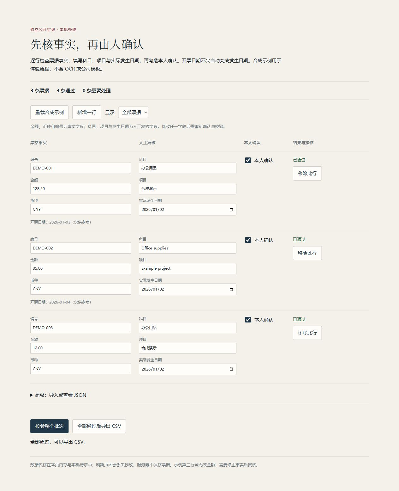
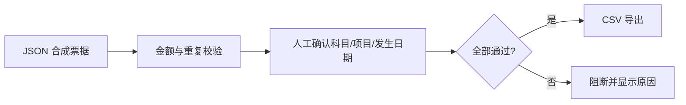

# 票据复核工作台｜合成数据演示

按公开需求独立实现的本地票据复核工作台，将确定性事实校验和人工决策分开。

> 公开方法演示 / Public methodology demo。合成数据不代表原项目成果，具体实现由 AI 编程工具辅助完成。

## 功能

- 金额、币种和批内重复编号由规则校验。
- 科目、项目和实际发生日期必须由人确认，不用开票日期代填。
- 异常阻断导出；CSV 防公式注入；CLI 拒绝覆盖已有文件。
- 本机网页支持逐行编辑、本人确认、待处理筛选和 CSV 导出；高级区支持 JSON 导入，不在服务端持久化。

## 本地运行

Python 3.11+。

```sh
python -m pip install -r requirements.txt
python workbench.py
python -m unittest discover -s tests -v
```

入口：`workbench.py / serve.py`。不需要 API Key、数据库、网络服务或付费模型。

网页复核：

```sh
python serve.py
```

打开 `http://127.0.0.1:8791`；停止进程即停止服务。在表格中核对事实，填写科目、项目与实际发生日期，再逐行勾选“本人确认”并点击“校验整个批次”。只有全部通过才可下载 CSV；修改字段会撤销该行确认并锁定导出。不要用此公开演示处理真实业务资料。

## 网页操作体验



1. 首次加载三条合成示例；人工确认不会自动勾选。
2. 填写缺失人工字段，核对示例第三行无效金额；修正事实后再确认。
3. 校验后逐行显示中文原因，可筛选“需要处理”。通过数属于整个批次，筛选不会绕过导出门禁。
4. 修改任何字段后需要重新确认与校验。导出成功后服务器不保存数据；刷新会丢失修改。

可以新增/移除行，批次最多 200 行。重载/导入会在有修改时提示替换；高级 JSON 导入支持原有字段，导入后需重新确认。键盘焦点和逐行标签用于无鼠标操作。

## 流程



## 验证

本地验证记录见 [VERIFICATION.md](VERIFICATION.md)。GitHub Actions 在 push 与 PR 时运行相同的离线测试；本地通过不代表远端 CI 已通过。

## 数据与局限

不做 OCR、不调用 LLM、不读取 Excel 模板；仅支持 JSON 输入与 CSV 导出。批内查重不等于跨批次查重，人工确认字段不代表凭证真实性已核实。不是公司原系统，未复用原公司代码或规则；不继承内部 88/90 等评测结果。

只有三条合成票据。不包含真实票据、税号、员工信息、公司科目、长期记忆或会话记录。

## 许可与贡献

独立公开实现代码：MIT。合成样例随仓库发布，不向使用者授予任何第三方商业数据权利。没有捆绑原公司或团队源码。依赖与公开接口归因见 [NOTICE](NOTICE)。

[作品集](https://github.com/Willow-Tokoton-Hitorineko/research-portfolio) · [个人主页](https://github.com/Willow-Tokoton-Hitorineko)
